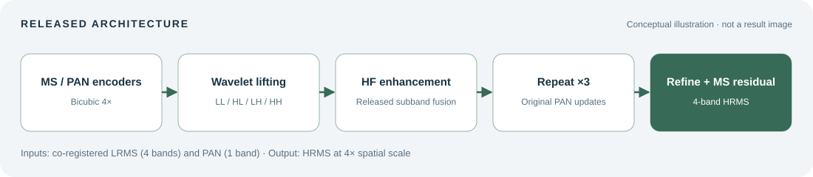

<div align="center">

# WINet

### Pan-Sharpening With Wavelet-Enhanced High-Frequency Information

**IEEE TGRS · 2024 · Official research implementation**

Jie Zhang, Xuanhua He, Keyu Yan, Ke Cao, Rui Li, Chengjun Xie, Man Zhou, Danfeng Hong

[Paper](https://doi.org/10.1109/TGRS.2024.3367165) · [Modern implementation](modern/README.md) · [Project website source](docs/) · [Compatibility CI](https://github.com/alexhe101/WINet/actions/runs/45547477493)

[](https://github.com/alexhe101/WINet/actions/workflows/modern-pytorch.yml)

</div>



## Overview

A wavelet-enhanced pan-sharpening network that uses frequency-selective lifting and high-frequency enhancement to recover detail while combining multispectral and panchromatic observations.

## Compatibility-first release

The new standalone package under `modern/` is derived from the exact public release, not a new architecture. The original implementation and experiment configuration are retained.

- Separate wavelet transforms, lifting/HF enhancement, reconstruction and the network.
- Keep all LL/HL/LH/HH operations, stage order, bicubic interpolation with align_corners=True, active and inactive registered parameter names (including wop3).
- Replace hardcoded CUDA output allocation in IWT with input-device allocation, keeping the released FP32 output dtype. No wavelet library substitution or changed subband order.
- The old source, training code and evaluation scripts remain available.

## Quick start

```bash
git clone https://github.com/alexhe101/WINet.git
cd WINet
git switch refactor/modern-pytorch
```


```bash
python -m pip install -e './modern[dev]'
python -m pytest modern/tests -v -rs
```

```python
from winet import build_model, load_weights, predict
import torch

model = build_model(device="cpu").eval()
load_weights(model, "your_checkpoint.pth")
ms = torch.rand(1, 4, 32, 32, device="cpu")
pan = torch.rand(1, 1, 128, 128, device="cpu")
with torch.inference_mode():
    hrms = predict(model, ms, pan)
```

The above uses random inputs for an API demonstration only. Follow [data and radiometry conventions](modern/README.md#input-and-output-contract) for real data.

```bash
winet infer --device cpu --checkpoint your_checkpoint.pth --input scene.npz --output result.npz
winet train --device cpu --data paired_train --output runs/train
```

## Weights and reproducibility

The state dict names and shapes remain the same as the released `Net`. The strict loader handles bare weights or the original `net` wrapper and an all-keys DataParallel prefix. Unused registered tensors are deliberately retained. The repository does not contain public trained checkpoints. Tests use the actual released model's initialized weights, not recovered pretrained weights.


## Research results

The HFIPS research announcement includes the original network and high-frequency enhancement diagrams. The full experimental tables are in the IEEE publication; no unverified numbers are reproduced here.

[Original result source](https://english.hf.cas.cn/nr/rn/202403/t20240312_658124.html)

## Validation and scope

The suite compares the refactored model against the actual published source at width 4 and width 32: state-dict keys, strict loading, outputs, input gradients and every active parameter gradient. The CPU reference changes only the original IWT allocation's device; DWT/IWT roundtrip is checked separately. It also checks the CLI and one-step synthetic training. These are regression tests on synthetic inputs; they are not remeasurements of the paper's dataset quality.

[CI record](https://github.com/alexhe101/WINet/actions/runs/45547477493). Full dataset reproduction and GPU performance are not claimed by the refactor.

## Repository layout

| Path | Purpose |
|:--|:--|
| [modern/src/winet/](modern/src/winet/) | Modular implementation |
| [modern/tests/](modern/tests/) | Release and checkpoint regression |
| [modern/README.md](modern/README.md) | Installation, data, compatibility details |
| [model/winet.py](model/winet.py) | Untouched original model |
| [option.yml](option.yml) | Untouched original training configuration |
| [docs/](docs/) | Static project website |

The legacy training entry point is `main.py`; the original testing script is `test.py`. Configure paths and the historical dependencies before using them. The original training data are not distributed.

## Citation

```bibtex
@article{zhang2024winet,
  title = {Pan-Sharpening With Wavelet-Enhanced High-Frequency Information},
  author = {Zhang, Jie and He, Xuanhua and Yan, Keyu and Cao, Ke and Li, Rui and Xie, Chengjun and Zhou, Man and Hong, Danfeng},
  journal = {IEEE Transactions on Geoscience and Remote Sensing},
  volume = {62},
  pages = {1--14},
  year = {2024},
  doi = {10.1109/TGRS.2024.3367165}
}
```
